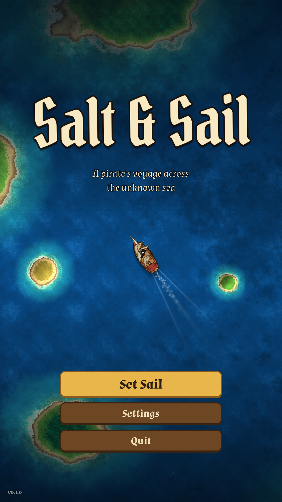

# Salt & Sail

A top-down pirate exploration roguelite for Android, built in Godot 4. Portrait,
one-thumb sailing across a procedural archipelago under fog of war and changing
weather. Working title; see `PROGRESS.md` for status and open questions.



## Run it

1. Install Godot 4.3 or newer (4.7 verified too), Compatibility renderer.
2. Open the folder as a project, or from a terminal: `godot --path .`
3. On desktop: drag with the mouse to steer, or use WASD / arrow keys / a gamepad
   stick. `Esc` pauses, `M` opens the chart. Debug builds: `F1`-`F5` force
   clear / fog / rain / storm / night, `F6` reveals the whole map.

## Layout

| path | what |
|---|---|
| `scripts/world/` | world generation, fog of war, the `Sea` scene logic |
| `scripts/entities/` | ship (physics + code-drawn visual), wake, points of interest, wildlife |
| `scripts/weather/` | weather state machine and the screen-space atmosphere pass |
| `scripts/ui/` | HUD, joystick, minimap/chart, title, menus |
| `scripts/autoload/` | `Dev` (command-line switches), `Game` (settings, save, shader globals), `Sfx` (audio) |
| `shaders/` | `world` (the whole sea in one quad), `atmosphere` (night/fog/rain), `chart` |
| `assets/` | fonts (OFL), noise atlas, generated placeholder audio, icons |
| `tools/` | generators for audio, noise and icons; `run.sh` test runner |
| `docs/` | design summary, architecture, Android export guide |
| `store/` | Play Store icon, screenshots, draft listing |

`docs/ARCHITECTURE.md` explains how the pieces fit together.

## Regenerating assets

```
python3 tools/gen_textures.py   # noise atlas (needs numpy, Pillow)
python3 tools/gen_audio.py      # placeholder audio (needs numpy, ffmpeg)
python3 tools/gen_icons.py      # launcher icons (needs Pillow)
```

## Automated screenshots (developer switches)

Anything after `--` goes to the `Dev` autoload:

```
tools/run.sh res://scenes/main.tscn -- --start=voyage --seed=7 --weather=storm \
    --at=2557,14586 --autopilot --shot=/tmp/storm.png --frames=140
```

Useful flags: `--start=voyage|title`, `--seed`, `--weather=clear|fog|rain|storm|night`,
`--at=x,y`, `--reveal`, `--discoverall`, `--open=chart|pause|settings|summary`,
`--autopilot`, `--quality=0|1|2`, `--timescale=N`, `--perf`, `--shot=path --frames=N`.
`tools/run.sh` runs under Xvfb with software GL; set `GODOT=/path/to/godot`.

## Building for Android

See `docs/ANDROID-EXPORT.md`.

## Credits

Fonts: Pirata One and Almendra (SIL Open Font License, see `assets/fonts`).
Everything else, including all audio and art, is generated by code in this repository.
